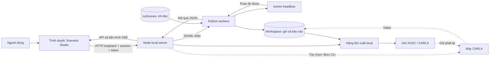
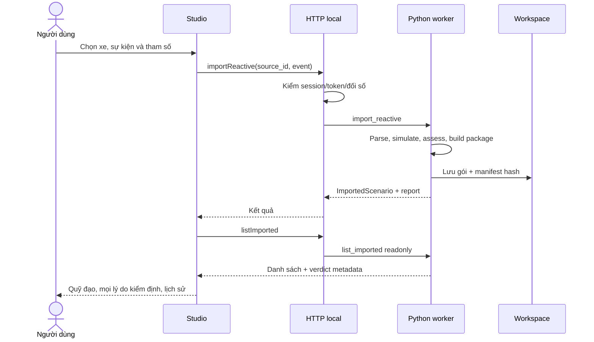

# Kiến trúc hệ thống Topeye

Ngày lập: 18/10/2026. Snapshot tài liệu `0.43.2`, chức năng Scenario Studio `0.43.1`. Tài liệu mô tả mã nguồn hiện có; không coi kiến trúc Blender/NuRec lịch sử là runtime MVP.

## 1. Bối cảnh và ranh giới

Người dùng chạy trình duyệt và server trên cùng máy. Dataset nuScenes là nguồn chỉ đọc. Workspace là nơi ứng dụng ghi kịch bản, lần chạy, báo cáo và bản xuất. CARLA/Brev là tích hợp ngoài tùy chọn; không nằm trên đường bắt buộc của pipeline esmini.



Sơ đồ độc lập để chèn vào báo cáo/slide: [architecture.svg](architecture.svg).

## 2. Thành phần và trách nhiệm

| Thành phần | Mã nguồn | Trách nhiệm |
| --- | --- | --- |
| Access và thư viện dữ liệu | `frontend/src/scenario/AccessApp.tsx`, `frontend/server/local-auth.mjs`, `dataset-catalog.mjs` | Tài khoản local, chọn dataset, kiểm tra dataset trước khi sử dụng |
| Scenario Studio | `frontend/src/scenario/studio/ScenarioStudio.tsx` | Điều phối cảnh, lịch sử, viewer, tạo/sửa/phân tích/lưu |
| Viewer | `TrackView.tsx`, `TacticalMap.tsx`, `LidarPointCloud3D.tsx` | Hiển thị dữ liệu và thời gian; không thay thế bộ kiểm định Python |
| Thiết kế kịch bản | `authoring/`, `workspace/ScenarioWorkspace.tsx` | Mẫu, tham số, sự kiện, so sánh baseline/pilot |
| HTTP local và bridge | `frontend/server/local-server.mjs`, `worker-bridge.mjs` | Kiểm request, phân tuyến, xếp hàng worker, phát tiến trình |
| Dataset và source scene | `backend/topeye/core/adapters/`, `scenario/source_scene.py` | Đọc dữ liệu và chuẩn hóa cảnh; giữ nguồn chỉ đọc |
| Template và importer | `scenario/template.py`, `xosc_import.py`, `real2sim.py` | Compile mẫu, kiểm profile, nạp/lưu gói tương ứng |
| Phản ứng | `scenario/reactive.py`, `reactive_package.py` | Tính chuyển động baseline/pilot, đánh giá, tạo XOSC/CSV/report |
| Engine và chỉ số | `scenario/replay.py`, `scene_metrics.py`, `replay_metrics.py`, `reactive_metrics.py`, `esmini_check.py` | Chạy esmini, đo sai số và thống kê theo định nghĩa từng bộ đo |
| Thư viện và xuất | `scenario/library.py`, `export_job.py`, `frontend/server/scenario-exports.mjs` | Đọc lịch sử, bản xuất bất biến, hàng đợi và tải file |
| CARLA tùy chọn | `frontend/server/carla-render.mjs`, `backend/scripts/carla_replay.py` | Điều phối máy CARLA và tạo video, có cấu hình máy riêng |

Các đường dẫn rút gọn ở bảng được tính tương đối từ `frontend/src/scenario/` hoặc `backend/topeye/` theo cột tương ứng.

## 3. Thiết kế tiến trình và worker

Server Node tạo các bridge Python riêng cho công việc chính, số liệu và LiDAR/đọc thư viện. Mỗi bridge xếp hàng request; việc có nhiều bridge không có nghĩa được ghi đồng thời tùy ý vào cùng gói. Tác vụ xuất chạy trong tiến trình riêng để vẫn đọc được tiến độ khi xử lý lâu.



Một cặp so sánh tạo hai gói với cùng sự kiện, lần lượt baseline và pilot; metadata nhóm giữ liên kết. Nếu chỉ tạo xong baseline, giao diện báo trạng thái chưa hoàn tất thay vì giả lập pilot.

## 4. Luồng dữ liệu và lưu trữ

```text
Dataset nuScenes (read-only)
  -> adapter -> source scene + map context
  -> template compiler hoặc reactive simulation hoặc package importer
  -> <workspace>/<scenario-id>/import/
       manifest.json, scenario.json, context.json, các payload theo loại gói
  -> runs/ và metrics/ khi có phép chạy/đo tương ứng
  -> <workspace>/exports/<job-id>/
       job.json, gói xuất, manifest và video tùy chọn
```

- Legacy CLI extraction dùng `bundle/` và `runs/`; gói imported/real2sim dùng `import/`. Không dùng chung schema cho mọi thư mục một cách ngầm định.
- Manifest dùng hash để phát hiện payload bị thay đổi. Bản xuất là bản sao; không viết đè gói nguồn.
- Xóa kịch bản/lần chạy đưa vào `.trash` theo luồng giao diện. Dọn `.trash` là thao tác riêng có xác nhận.
- Tài khoản, catalog và settings ở userData; session nằm trong RAM. Restart server có thể yêu cầu đăng nhập lại.
- Cache chỉ số là dữ liệu dẫn xuất; không được coi cache là dataset gốc hoặc bằng chứng cho lần chạy chưa diễn ra.

## 5. An toàn và tính đúng đắn

| Ranh giới | Cơ chế hiện có | Giới hạn |
| --- | --- | --- |
| Browser → HTTP | Bind loopback, kiểm Host/Origin/token và session | Không chứng nhận cho triển khai Internet nhiều người dùng |
| Tài khoản local | scrypt + salt, cookie HttpOnly/SameSite, giới hạn thử đăng nhập | Không có hệ thống tài khoản tổ chức/SSO |
| Request → worker | Allowlist thao tác/đối số, mã lỗi cụ thể, hàng đợi | Tác vụ dài có thể cần hủy/chờ |
| Workspace → dataset | Kiểm đường dẫn, từ chối output nằm trong dataset, kiểm symlink ở các đường nhạy cảm | Vẫn cần quyền file và dữ liệu hợp lệ trên máy chủ |
| Gói XML | Profile/tập action giới hạn, giới hạn kích thước, xác minh manifest | Không phải interpreter OpenSCENARIO đầy đủ |
| Kết quả bất đồng bộ → UI | Generation guard, hủy tác vụ, bỏ kết quả cũ | Không thay thế kiểm định vật lý |

## 6. Những lựa chọn có chủ ý

1. **File và worker local:** phù hợp MVP chạy cùng dataset trên máy, không cần database hoặc GPU cho luồng esmini.
2. **UI tách phép đo:** viewer hiển thị pose; engine/bộ đo mới tạo bằng chứng phát lại. Chuyển động đẹp mắt không tự chứng minh kịch bản đạt.
3. **Đường nạp riêng:** mẫu/XOSC tác giả chịu cổng map/profile riêng; gói real2sim phát lại dữ liệu ghi dùng parser khác và ghi chú map. Không nới profile của đường này để nhận dữ liệu của đường kia.
4. **Trạng thái có nhiều nghĩa:** tạo thành công, đạt kiểm định, đã chạy esmini và xuất thành công là các trạng thái riêng.
5. **CARLA tùy chọn:** việc điều phối máy, chi phí và kết quả video được quản lý riêng; không suy ra thành công từ việc có nút giao diện.

## 7. Triển khai hiện tại và hướng mở rộng

Đã kiểm chứng trên macOS arm64: browser + Node + Python + esmini trên cùng máy. Chưa có Live URL công khai được nghiệm thu trong hồ sơ này.

Public hosting cần thiết kế bổ sung về tài khoản, cách nạp/lưu dataset, sandbox tác vụ, quota, HTTPS và cô lập workspace. Phản ứng theo hành vi ego thay đổi lúc chạy cần mô hình closed-loop; gói quỹ đạo hiện tại chưa cung cấp khả năng đó. Đây là hướng phát triển, không phải tính năng đã giao.
