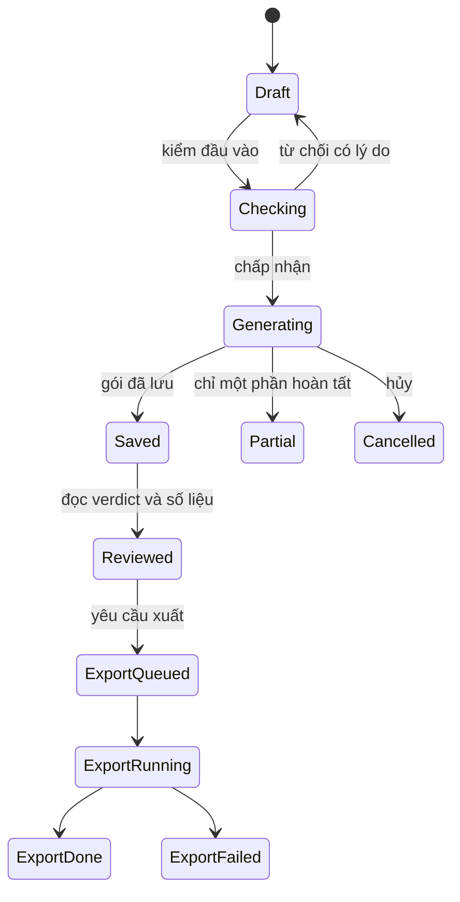

# Đặc tả yêu cầu và thiết kế ReCast

Ngày: 18/10/2026 · Mã tài liệu: SDD-01 · Snapshot: `0.43.2` (bản vá tài liệu).

## 1. Mục tiêu, người dùng và phạm vi

**Mục tiêu:** biến dữ liệu quỹ đạo giao thông thành kịch bản có thể xuất, phát lại và đo; hỗ trợ tạo tình huống mới và so sánh phản ứng. Người dùng mục tiêu là người nghiên cứu/kiểm thử kịch bản giao thông và người đánh giá sản phẩm.

Phạm vi lõi N3-09B trong hồ sơ dự án gồm: đọc nuScenes, xuất OpenSCENARIO, phát lại, sinh biến thể tốc độ/khoảng cách, đo sai số và đếm kịch bản đạt. Hồ sơ hiện tại là bản diễn giải từ repo; ảnh đề nguyên văn về chức năng chưa nằm trong bộ tài liệu. Yêu cầu hồ sơ nộp do chủ dự án cung cấp ngày 18/10 gồm README, kiến trúc, đặc tả/thiết kế và kiểm thử, nhật ký tuần cùng các hạng mục truyền thông/Live URL riêng.

**Không thuộc cam kết hiện tại:** tự lái closed-loop đầy đủ, kiểm định an toàn ngoài đời, mô phỏng cảm biến đã hiệu chuẩn, digital twin chân thực, huấn luyện perception đạt chất lượng công bố, AI sinh kịch bản thực, SaaS/public hosting hoặc hỗ trợ đã nghiệm thu mọi hệ điều hành.

## 2. Yêu cầu chức năng và truy vết

| ID | Yêu cầu và hành vi nghiệm thu | Thành phần | Trạng thái |
| --- | --- | --- | --- |
| FR-01 | Tạo/đăng nhập tài khoản local; không trả dữ liệu khi chưa được xác thực | AccessApp, local-auth/local-server | Có |
| FR-02 | Thêm dataset nuScenes, liệt kê cảnh; báo lỗi khi đường dẫn/dữ liệu không hợp lệ | dataset-catalog, adapter/worker | Có; catalog hiện chỉ nhận nuScenes |
| FR-03 | Xem cảnh 2D/3D và timeline đồng bộ; không tự bịa pose ngoài vùng hỗ trợ | Studio, TacticalMap, TrackView | Có |
| FR-04 | Tạo mẫu và kiểm tham số, map/profile trước khi lưu; trạng thái va chạm vẫn có thể được lưu và gắn cờ | authoring, template, xosc_import | Có |
| FR-05 | Chọn xe/sự kiện/thời điểm hợp lệ; tạo baseline và pilot cho cùng sự kiện | ScenarioWorkspace, reactive | Có trong phạm vi engine hỗ trợ |
| FR-06 | Nạp XOSC/gói real2sim, từ chối action ngoài tập hỗ trợ với lý do | xosc_import, real2sim | Có; không nhận mọi OSC tùy ý |
| FR-07 | Xuất gói, phát lại esmini và đo coverage/sai số từ pose engine | export, replay, metrics/esmini_check | Có; một số phép đo cần được gọi riêng |
| FR-08 | Sinh biến thể tốc độ và dịch dọc quỹ đạo | variants, CLI/worker | Có ở backend/CLI; không có form biến thể riêng trên UI chính |
| FR-09 | Báo cáo chỉ số, số kịch bản đạt/hiếm và mọi lý do chưa đạt | metric modules, Analysis, validity | Có; định nghĩa phụ thuộc bộ đo |
| FR-10 | Mở lại, sửa theo loại, xóa có xác nhận và giữ lịch sử theo gói | library, Studio | Có; real2sim nhập ngoài chỉ xem |
| FR-11 | Xuất XOSC hoặc gói CARLA, có tiến độ và file tải về | export_job, scenario-exports | Có |
| FR-12 | Dựng video CARLA sau xe/trong xe khi có cấu hình máy | carla-render, carla_replay | Tích hợp tùy chọn; không chứng nhận vận hành remote bởi đợt đo này |

## 3. Yêu cầu phi chức năng

| ID | Yêu cầu | Cách chứng minh / giới hạn |
| --- | --- | --- |
| NFR-01 | Giữ dataset chỉ đọc; đầu ra ở workspace riêng | Guard đường dẫn và regression tests; không nhận đầu ra nằm trong dataset |
| NFR-02 | Phân biệt dữ liệu đo, tính toán và hiển thị ước lượng | Nhãn nguồn, report, diễn giải giới hạn; không dùng hình ảnh 3D làm bằng chứng đo |
| NFR-03 | Hủy/chuyển cảnh không ghi nhận kết quả cũ | Generation guard, worker/job tests |
| NFR-04 | Gói lưu/xuất có thể kiểm tra toàn vẹn | Manifest hash, xác minh khi mở/phát lại theo loại |
| NFR-05 | Giao diện vẫn phản hồi với tác vụ dài | Worker riêng, hàng đợi, tiến độ; không cam kết SLA thời gian cố định |
| NFR-06 | Trạng thái thiếu số liệu là `null`/chưa kiểm, không thành số 0 hoặc tự đạt | Report contracts và component tests |
| NFR-07 | Không đưa credentials vào source | Cấu hình máy/tài khoản ở local; kiểm request và phân quyền session |

## 4. Use case

### UC-01 — Mở và quan sát cảnh

Điều kiện: server local đang chạy, người dùng đăng nhập, có dataset đọc được. Người dùng mở dataset/cảnh, xem bản đồ và timeline. Nạp cảnh thất bại phải có thông báo; nguồn khác/cảnh khác không được xuất hiện dưới tên cảnh đang chọn. Thiếu LiDAR/map được xử lý theo khả năng từng màn; cảnh xem được không tự bảo đảm tạo được kịch bản.

### UC-02 — Tạo và so sánh phản ứng

Người dùng chọn xe có cửa sổ hỗ trợ, loại sự kiện, thời điểm và tham số. App có thể kiểm trước rồi lần lượt lưu baseline/pilot. Thành công: hai gói và metadata nhóm được lưu, quỹ đạo có thể xem và phân tích. Nếu pilot không hoàn tất sau khi baseline đã lưu, app phải nói rõ phần đã lưu và phần chưa xong. Nếu tạo thành công nhưng `valid=false`, hiển thị mọi lý do thay vì báo chung là tạo thất bại.

### UC-03 — Tạo từ mẫu hoặc nạp gói

Template được kiểm cấu trúc/tham số ở client, compile và kiểm map/profile ở Python. XOSC nhập tay đi qua cổng riêng; real2sim dùng parser tập hành vi phát lại. Không được nới một profile để nhận mọi loại gói. Chỉ số/diagnostic đi theo gói đã nạp.

### UC-04 — Phân tích và xuất

Người dùng mở lịch sử → Phân tích → xem kết luận/diễn biến/kiểm định/từng xe → Lưu/xuất. Tác vụ xuất có trạng thái riêng. Việc ZIP xuất thành công không chứng minh chạy CARLA thành công. Khi gói không có số liệu, hiển thị thiếu dữ liệu thay vì suy diễn.

## 5. Contract dữ liệu

Nguồn đầy đủ: [types.ts](../../frontend/src/scenario/types.ts), [reactiveTypes.ts](../../frontend/src/scenario/reactiveTypes.ts), [worker.py](../../backend/topeye/scenario/worker.py). Các bảng dưới đây là những trường chính, không thay thế toàn bộ schema trong code.

### 5.1. Pose và actor

| Trường | Kiểu / ý nghĩa |
| --- | --- |
| `t_s` | Số giây theo trục thời gian cảnh/gói |
| `x_m`, `y_m`, `z_m` | Vị trí tính bằng mét trong hệ tọa độ đã khai báo |
| `yaw_rad` | Hướng tính bằng radian |
| `observed` | Cờ mốc quan sát khi contract tương ứng cung cấp |
| Actor `id`, `role`, `category` | Định danh, ego/traffic, loại đối tượng |
| `length_m`, `width_m`, `height_m` | Kích thước dương, dùng cùng quy ước điểm tham chiếu |
| `samples` | Chuỗi pose có thời gian tăng dần |

Không ngoại suy qua ngoài miền hỗ trợ; không gắn tọa độ local của clip này vào map của clip khác. Quy ước ego nuScenes và tâm hộp khác nhau; engine phản ứng xử lý offset tâm hộp riêng, không coi ego pose là tâm xe trong mọi phép tính.

### 5.2. Template, sự kiện và báo cáo

- Template profile: `topeye-scenario-template-v1`; có actor, route, speed, events, environment và thông tin map/placement.
- Sự kiện chung: `actor_id: string`, `t0_s: number`, `react: boolean`, `reaction_s: number`, `kind` thuộc `brake | accelerate | stopline | lane_change` (mặc định brake).
- Theo loại: brake có `decel_mps2`, `target`, `dwell_s`; accelerate có `target_mps`, `accel_mps2`; stopline có `dwell_s`; lane_change có `direction`, `duration_s`. Trường sai loại bị từ chối.
- `target=hold` là đứng yên đến hết; `target=stop` dừng theo thời gian dwell rồi đi tiếp. Cấm dùng hai giá trị như từ đồng nghĩa.
- `Real2simReport.valid` có thể là `true | false | null`; `reasons: string[]` giữ các nguyên nhân; `group` là phân nhóm kết quả hoặc thiếu dữ liệu theo contract.
- `CheckResult` gồm `id`, `passed: boolean | null`, `value`, `threshold`, `unit`, `t`, `detail`. `null` không phải thất bại hoặc đạt.
- Metadata thư viện real2sim có `report.reasons?` và `report.react?`; client phải chịu được server/gói cũ thiếu trường. Không ghi lại report cũ chỉ để đổi câu chữ.

### 5.3. Các profile và đường nạp

| Đường nạp | Contract | Luật |
| --- | --- | --- |
| Mẫu / XOSC tác giả | `topeye-map-trajectories-v1`, vị trí thế giới và quỹ đạo có thời gian trong tập hỗ trợ | Kiểm profile/map; không phải OSC runtime đầy đủ |
| Gói real2sim | `real2sim-replay-v1`, XOSC + report/CSV tùy có | Parser riêng cho hành vi phát lại, ghi chú map không đồng nghĩa cổng template |
| Legacy CLI extraction | Scenario schema version 1, bundle/reference riêng | Phạm vi clip hẹp; không dùng giới hạn actor của CLI để mô tả toàn cảnh nguồn |

Gói real2sim có giới hạn XOSC 4 MiB, report 256 KiB, CSV 1,5 MiB và tổng payload base64 khoảng 7,8 MiB tại server. Kiểm phiên bản/capability của profile thay vì suy từ phần mở rộng `.xosc`.

## 6. Contract API chính

API dưới đây dùng `POST /api/<method>`, JSON body, session và header `x-topeye-token`; thành công trả `{ "value": ... }`, thất bại trả `{ "code": ..., "message": ... }`. Ngoại lệ như login/setup, SSE và tải file có route riêng trong server.

| Method | Trường đầu vào chính | Kết quả / hành vi |
| --- | --- | --- |
| `sourceScene` | `scene` | Cảnh nguồn và `source_id` dùng cho thao tác tiếp |
| `importTemplate` | `source_id`, `template` | ImportedScenario sau compile/kiểm/lưu |
| `importReactive` | `source_id`, `event` | ImportedScenario và report; `valid=false` vẫn có thể trả thành công |
| `importXosc` | `source_id`, `xml_base64`, `file_name` | Gói nạp qua profile XOSC tác giả |
| `importPackage` | `source_id`, `files` | Gói real2sim được parse và lưu |
| `reactiveSensitivity` | `source_id`, `event` | Các kết quả theo độ trễ phản ứng, không tự lưu thành gói |
| `listImported` | Object rỗng | Thư viện, metadata verdict, lịch sử |
| `openImported` | `source_id`, `path` | Kiểm và mở gói trên nguồn tương ứng |
| `reactiveMetrics` | `scene`, `reactions?`, `kinds?` | Thống kê theo cảnh và loại sự kiện |
| `replayErrorMetrics` | `scene` | Đo quỹ đạo exact/baseline/pilot theo bộ đo |
| `esminiCheck` | `scenario_id` | Kết quả kiểm esmini riêng cho gói hỗ trợ |
| `exportScenario` | `scenario_id`, `format: carla | xosc` | Tạo job xuất và xếp hàng |
| `renderCarla` | `id`, `view: chase | driver` | Job dựng video tùy cấu hình, có thể tốn tài nguyên remote |

Giao thức worker là JSONL stdio, không phải API public thứ hai. Python worker không tự mở socket.

## 7. Phân loại lỗi và hành vi caller

| Loại | Ví dụ | Hành vi bắt buộc |
| --- | --- | --- |
| Chưa xác thực/quyền | `UNAUTHENTICATED`, `FORBIDDEN` | Yêu cầu đăng nhập hoặc báo quyền; không đọc/ghi dữ liệu nghiệp vụ |
| Đầu vào/profile/map | `INVALID_INPUT`, `EVENT_NOT_ALLOWED`, `UNSUPPORTED_XOSC` | Hiện lý do để chỉnh đầu vào; không tự nới ngưỡng/profile |
| Bận/hủy | `BUSY`, `CANCELLED` | Chờ/thử lại có kiểm soát hoặc kết thúc hủy; bỏ kết quả cũ |
| Tài nguyên/engine/hash | `ENGINE_MISSING`, `ENGINE_FAILED`, `HASH_MISMATCH` | Báo lỗi vận hành/toàn vẹn; không ghi nhận engine đạt |
| Verdict kịch bản | HTTP thành công nhưng `report.valid=false` | Vẫn mở gói đã tạo; hiện đủ reasons và trạng thái kiểm riêng |
| Chưa có phép đo | `passed=null`, số liệu thiếu | Hiện “chưa kiểm”/“—”; không gán giá trị giả |

Mapping HTTP hiện tại: xác thực 401, quyền 403, rate-limit 429, busy/cancel 409, lỗi worker/server được phân loại 500; mã lỗi đầu vào nghiệp vụ thường 400. Không suy từ tên `NOT_FOUND` rằng mọi route nghiệp vụ đều trả 404; allowlist/mapping trong `local-server.mjs` là nguồn đúng.

## 8. Thiết kế kiểm định và diễn giải

| Cổng | Đánh giá gì | Không chứng minh điều gì |
| --- | --- | --- |
| Kiểm tham số client | Cấu trúc/template và phạm vi giá trị | Chưa kiểm chuyển động thực trên map |
| Compile/import | Profile, map, dữ liệu và diagnostic theo đường nạp | Không tự chứng minh phản ứng vật lý hoặc chạy CARLA |
| Reactive assessment | Giới hạn vật lý, nguồn, va chạm, bám sát, tương tác chưa hỗ trợ | Không là chứng nhận an toàn ngoài đời |
| esmini replay | Engine hoàn tất, coverage và sai số theo bộ đo | Khớp quỹ đạo tính sẵn không chứng minh tính đúng của mọi giả định nguồn |
| CARLA/video | Kết quả thực của job tùy chọn | Có file xuất không đồng nghĩa job đã chạy thành công |

Reactive assessment xét toàn bộ quỹ đạo của xe đổi chuyển động, kể cả trước sự kiện. `label_error` là heuristic so vị trí vi phạm với nguồn trong 5 m; UI gọi “Dữ liệu nguồn cần kiểm tra”. Pilot áp quy tắc ego va chạm; baseline và một số thống kê theo cảnh giữ luật đo riêng. Không gộp số lượng của các bộ đo khác định nghĩa.

Ngưỡng của legacy CLI replay và ngưỡng reactive khác nhau: ví dụ báo cáo CLI đo tracking có ngưỡng ADE 0,25 m/max 0,5 m và gia tốc 10 m/s², còn reactive dùng ngưỡng tăng tốc 4 m/s². Người đọc phải xem `thresholds` của phép đo, không lấy một ngưỡng áp cho mọi báo cáo.

## 9. Trạng thái và tính bền vững

`Saved`/`Reviewed` không quy định `valid=true`. Verdict và tình trạng esmini là các thuộc tính riêng. Job xuất có trạng thái `queued/running/done/failed` theo contract triển khai; trạng thái hủy/gián đoạn cụ thể được mô tả trong từng module, không tự đổi tên theo sơ đồ khái niệm trên.

## 10. Tiêu chí hoàn thành và vùng cấm

- FR-01…FR-11 phải được đối chiếu với ma trận và kết quả trong [tài liệu kiểm thử](testing.md); FR-12 cần bằng chứng remote riêng nếu dùng để nghiệm thu.
- BẮT BUỘC giữ nguồn chỉ đọc, nêu dữ liệu chưa đo và giữ mọi lý do chưa đạt.
- CẤM đổi `valid=false` thành true chỉ để làm đẹp tỷ lệ; cấm bỏ vi phạm nguồn khỏi report mà không thay contract được duyệt.
- CẤM coi mock AI là AI thật, cảnh ước lượng là map khảo sát, hoặc local URL là Live URL công khai.
- CẤM gộp bằng chứng lịch sử với kết quả của build hiện tại mà không ghi ngày/phạm vi.
- Không sửa dữ liệu nguồn, triển khai public hay chạy job GPU/CARLA chỉ để hoàn thiện tài liệu.
